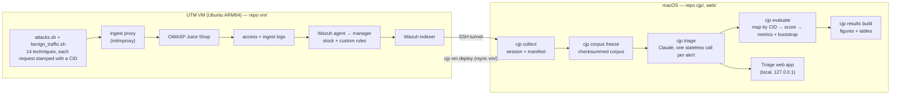

# LLM evals for SOC alert triage

Can an LLM triage SIEM alerts well enough for a SOC analyst to rely on it? This repo holds the pipeline and evaluation harness I built to answer that for my Master of IT capstone at QUT (IFN737/IFN738). It measures whether Claude gets the answer right, and also whether the output is calibrated, cheap enough and usable by an analyst.

Scripted attacks and benign traffic hit [OWASP Juice Shop](https://owasp.org/www-project-juice-shop/), [Wazuh](https://wazuh.com/) raises alerts, Claude triages each alert, and every alert is joined back to the request that caused it. That join gives a ground truth that neither the SIEM nor the LLM produces.

> **Status.** The code, method and design decisions are public. The **results are held back** while the work is being prepared for a conference submission (see [results/README.md](results/README.md)).

## Contents

- [Research questions](#research-questions)
- [How the evaluation works](#how-the-evaluation-works)
- [Architecture](#architecture)
- [Experiments](#experiments)
- [Output design: Format A vs Format B](#output-design-format-a-vs-format-b)
- [The Triage web app](#the-triage-web-app)
- [Quickstart](#quickstart)
- [Repository layout](#repository-layout)
- [Documentation](#documentation)
- [Not published here](#not-published-here)

## Research questions

- **RQ1 – triage correctness.** When an LLM triages SIEM alerts, how accurately does it (a) name the attack and (b) decide whether the alert needs escalation? How does this change when the SIEM and the LLM receive richer log evidence?
- **RQ2 – safe reliance.** How do output-design choices (abstaining vs committing, confidence reporting, schema length) affect how far an analyst can safely rely on the output? Measured by calibration, expert-rated actionability and token cost.

The method, every metric and the limitations were **pre-registered** in [docs/METHODS.md](docs/METHODS.md) before any experiment was run.

## How the evaluation works

The evaluation has six layers. Each one builds on the one before.

| # | Layer | What it does |
|---|---|---|
| 1 | **Ground truth** | Every scripted request carries a correlation ID (CID) in its `Referer` header. Wazuh copies it into the alert, so each alert joins deterministically to the request, technique and payload that caused it. It replaced an earlier timestamp-proximity heuristic. |
| 2 | **Scoring** | Each answer is `correct`, `wrong`, `abstained` or `no_answer`, scored separately for the fine label, the coarse label and the disposition (escalate / needs more info / dismiss), and for severity in Format A. |
| 3 | **Metrics** | Coverage, selective and strict accuracy, escalation recall, false-positive dismissal, the share of high-confidence answers that are wrong, and cost per correct answer at list price. |
| 4 | **Uncertainty** | 95% percentile bootstrap CIs (2,000 resamples, seed 0) that resample **distinct requests, not alerts**, because one request can raise several alerts. Three repeats give a min–max spread. |
| 5 | **Comparisons** | Evidence, format, model and baseline variants are compared with a paired cluster bootstrap. A change counts as a difference only when its interval excludes zero. |
| 6 | **Human judgment** | A blind expert rating of 48 stratified outputs on 5 rubric items, plus a heuristic review of the Triage UI against 11 published SOC criteria (Okazawa et al.). |

Scoring and metrics are explained in [decision 006](docs/decisions/006-scoring-and-metrics.md) and [METHODS](docs/METHODS.md).

## Architecture

Two hosts, one pipeline, one repo. Traffic generation, logging and detection run on an Ubuntu ARM64 VM (UTM). Collection, LLM triage and evaluation run on macOS. The VM runs this repo's [`vm/`](vm/) directory: `cjp vm deploy` copies it to `~/cjp-vm` on the VM and records the git SHA, so one commit pins both sides.



Three **SIEM evidence arms** show how much the LLM's answer depends on what the SIEM can see: the plain access log, the request body appended to the URL, and the body in its own field with purpose-built Wazuh rules ([ARCHITECTURE §3](docs/ARCHITECTURE.md#3-the-three-siem-evidence-arms)).

## Experiments

Each experiment is one YAML file in [`experiments/`](experiments/), run end to end with `cjp experiment run <ID>` over a frozen, checksummed corpus.

| ID | Question |
|---|---|
| D1 | What does each logging level let Wazuh see? |
| X0 | Does the LLM beat a lookup table (URL regex, Wazuh rule)? |
| X1 | How does evidence change correctness, coverage, disposition and calibration? |
| X2 | Does schema length change correctness, calibration or cost? |
| X3 | Where does a cheaper model sit on the cost–quality curve? |
| X4 | Does attacker text in a request body flip the verdict (prompt injection)? |

## Output design: Format A vs Format B

The output schema is treated as a design variable, not a fixed implementation detail. Both formats are enforced as structured output ([prompts/](prompts/), [decision 005](docs/decisions/005-prompt-v2-and-output-formats.md)).

- **Format A (full)** adds candidate labels, event type, severity, reasoning, cited evidence and notes on what the analyst should check.
- **Format B (short)** is the decision an analyst acts on: `technique_label`, `disposition`, `confidence`, `recommended_action`.

<figure style="text-align: center;">
  
  <figcaption style="textAlign:left;">Left: format A; right: format B</figcaption>
</figure>
<br/>


X2 tests whether the extra fields buy better or better-calibrated answers, or just cost more tokens. The expert rating and the heuristic UI review test which one an analyst can act on.

## The Triage web app

A local web app (FastAPI + React/TypeScript/Tailwind/shadcn) puts the pipeline in an analyst's hands, without memorising commands:

- **Home:** health checks from `cjp doctor`, in plain words.
- **Triage:** run Claude over a demo session, an uploaded alert file or a live Wazuh window, **after approving the estimated cost**. Shows a queue ("To act on" / "Needs a human"), each verdict in Format A or B with a calibration chip, a warning for instruction-like text in the request, and CSV/JSON export.
- **Rate:** the blind expert rating, one item per screen, autosaved, with an offline pack for a remote rater.
- **Results:** a read-only browser over experiment runs and their reports.

It binds to 127.0.0.1 only, with a Host allow-list, a CSP and no third-party origins ([decisions 013–017](docs/decisions/)).

## Quickstart

You need macOS (or Linux) with [uv](https://docs.astral.sh/uv/), an Anthropic API key, and a VM running the Wazuh single-node Docker stack. Full commands are in [docs/RUNBOOK.md](docs/RUNBOOK.md).

```bash
uv sync                       # Python 3.12 env from pyproject.toml + uv.lock
cp .env.example .env          # API key, Wazuh/indexer credentials, VM host
uv run cjp doctor             # checks config, API key, models, VM, Wazuh, Juice Shop and proxy
uv run cjp vm deploy          # copies vm/ to the VM, installs custom rules, smoke-tests all three arms
uv run cjp session new --seed 1           # one proxied session: attacks + benign traffic, collected
uv run cjp experiment run X1 --dry-run    # plan, paid calls and an upper bound on cost
uv run pytest                 # offline test suite: no API calls, no VM
```

The tests and `cjp doctor --selftest` run without a VM or an API key. On macOS, double-clicking `Start Triage.command` builds and opens the web app.

## Repository layout

| Path | What |
|---|---|
| `cjp/` | The pipeline package and its single CLI: `collect.py`, `indexer.py`, `vm.py` (collection), `triage/` (prompt, schema, Claude client, batch runner), `evaluate/` (CID mapper, scoring, metrics, calibration, baselines, injection, contrasts), `experiment.py`, `corpus.py`, `runs.py`, `cache.py`, `results.py`, `rating*.py` |
| `vm/` | Everything the VM runs: `deploy.sh`, `juice-shop/` (attack and benign traffic scripts, ingest proxy, compose file), `wazuh/` (custom decoder and rules, agent config, logtest cases) |
| `web/` | `api/` (FastAPI) and `ui/` (React, Vite, TypeScript, Tailwind, shadcn) |
| `experiments/` | D1 and X0–X4 definitions |
| `prompts/` | Triage prompt v2 and the Format A / B schemas |
| `taxonomy/`, `rubric/` | Closed label set mapped to OWASP Top 10 2025, baselines, expected decisions, expert rating rubric |
| `config/settings.yaml` | Models, request parameters, price table, bootstrap parameters (part of the method; machine-specific settings stay in `.env`) |
| `results/` | `canonical.yaml` (which run each figure comes from); built results withheld for now |
| `tests/` | pytest suite with a small synthetic session fixture |
| `docs/` | Method, architecture, runbook, decision records |

## Documentation

Start at the [docs index](docs/README.md).

- [METHODS.md](docs/METHODS.md): the pre-registered method.
- [ARCHITECTURE.md](docs/ARCHITECTURE.md): how the pipeline is built.
- [RUNBOOK.md](docs/RUNBOOK.md): setup and commands.
- [decisions/](docs/decisions/): 22 short records of design decisions and their trade-offs.
- [reference/](docs/reference/): Wazuh and VM notes, and the practitioner-study protocol kept as future work.

## Not published here

- **Results** (figures, tables, run data): held back until the paper is published.
- **Research data** (`data/`: sessions, corpora, runs, response cache, ratings): never tracked.
- **Internal plan and work log**: kept in the private working repo. "Plan §…" references in code comments point there.

## Licence and contact

No licence is granted yet, so all rights are reserved for now. If you'd like to use or build on this work, please get in touch via [jessewei.net](https://jessewei.net).

Built by Jesse Wei as part of a QUT Master of IT research capstone. Implemented with Claude Code.
